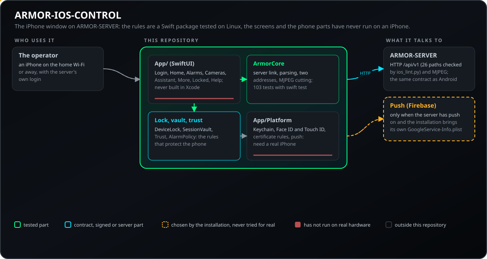
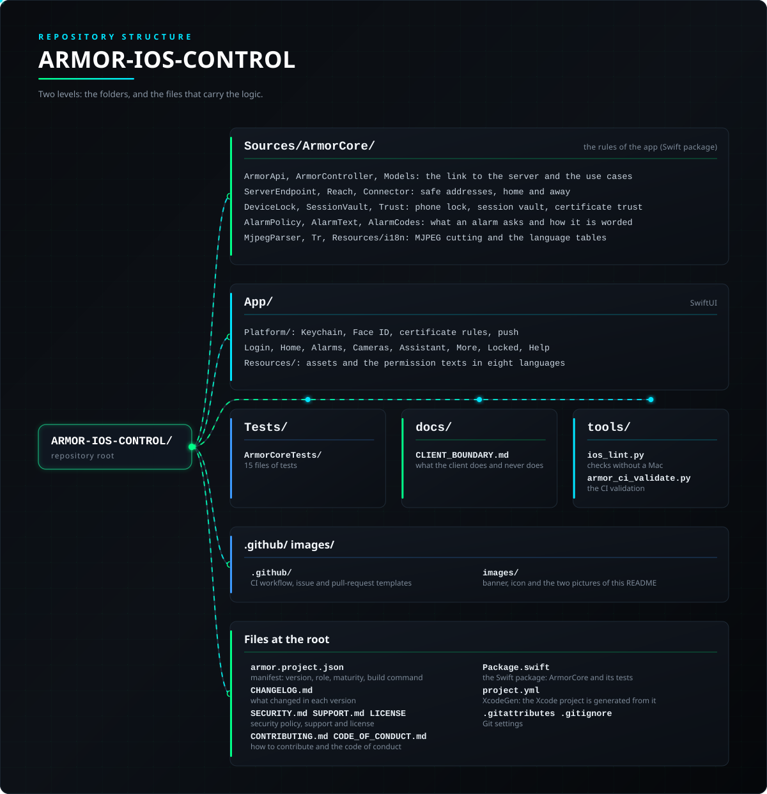

<p align="center">
  
</p>

# 📱 ARMOR-IOS-CONTROL

<p align="center">
  <a href="README.md">🇺🇸 English</a> |
  <a href="README_spa.md">🇪🇸 Español</a> |
  <a href="README_fra.md">🇫🇷 Français</a> |
  <a href="README_ita.md">🇮🇹 Italiano</a> |
  🇩🇪 <b>Deutsch</b> |
  <a href="README_zho.md">🇨🇳 简体中文</a> |
  <a href="README_jpn.md">🇯🇵 日本語</a> |
  <a href="README_por.md">🇵🇹 Português</a>
</p>

### iPhone-Bedienclient für ARMOR-SERVER: Status, Scharfschaltung, Alarme, Alarmzentralen, Kameras und der Assistent, in acht Sprachen

<p align="center">
  
  
  
  
  
  
  
</p>

---

**Ehrlichkeitsprüfung - was heute läuft:** Die Regeln der App (Serververbindung, Auswertung der Antworten, Adressauswahl, Telefonsperre, Tresor der Sitzung, Vertrauen in das Zertifikat, Alarmrichtlinie, Anwendungsfälle, MJPEG-Zerlegung) sind das Swift-Paket `ArmorCore`, abgedeckt durch 146 Unit-Tests, die mit `swift test` unter macOS oder Linux laufen; `tools/ios_lint.py` prüft Struktur, die acht Sprachtabellen und den Vertrag ohne Mac. **Noch nicht** belegt: Die SwiftUI-Bildschirme und die Teile, die ein iPhone brauchen (Face ID, Schlüsselbund, Zertifikatsregeln, Live-Kamera, Push über Firebase), wurden weder in Xcode gebaut noch auf einem Gerät ausgeführt.

---

## 📋 Auf einen Blick

| | |
|---|---|
| Version | `0.0.1` |
| Reifegrad | Gerüst |
| Rolle | iPhone-Bedienclient für ARMOR-SERVER (Familie: Clients, übergeordnet: ARMOR-SERVER) |
| Technik | Swift 5.9+ / SwiftUI, iOS 16+ |
| Tests | 146 (`swift test`) |
| Sprachen | 8 (241 Sätze je Sprache, von `ios_lint.py` geprüft) |
| Läuft auf | Ein iPhone mit iOS 16+; die Tests laufen auf macOS oder Linux |
| Auf echter Hardware | Noch nicht auf einem iPhone ausgeführt; die Regeln werden unter Linux getestet |
| Lizenz | GPL-3.0-or-later |

**Springe zu:** [Überblick](#-überblick) · [Architektur](#-architektur) · [Sicherheit](#-sicherheit-und-schutz) · [Schnittstellen](#-schnittstellen) · [Konfiguration](#-konfiguration) · [Schnellstart](#-schnellstart) · [Tests](#-tests) · [Probleme](#-fehlerbehebung) · [Struktur](#-struktur-des-repositorys) · [Verwandte](#-verwandte-projekte)

## 🚦 Projektstatus

Jede Zeile ist ein Teil dieses Repositorys, und die Ampel sagt, wie weit er heute ist. Sie beruht auf dem, was das Repository zeigen kann (Tests, Builds, Läufe), nicht auf dem, was geplant ist.

🟢 Fertig und überprüft · 🟡 Funktioniert, mit bekannten Grenzen · 🟠 Teilweise fertig oder noch nicht überprüft · 🔴 Nicht gemacht oder funktioniert nicht

| Bereich | Stand | Was das hier bedeutet |
|---|---|---|
| Software | 🟠 | Die Regeln der App sind ein Swift-Paket (`ArmorCore`); die SwiftUI-Bildschirme wurden nicht in Xcode gebaut. |
| Tests | 🟡 | 146 Unit-Tests bestehen mit `swift test` unter macOS oder Linux, und `tools/ios_lint.py` prüft Struktur, die Tabellen der acht Sprachen und den Vertrag ohne Mac; auf einem Gerät läuft kein Test. |
| Oberfläche | 🟠 | Die SwiftUI-Bildschirme sind geschrieben, wurden aber weder in Xcode gebaut noch auf einem iPhone ausgeführt. |
| Hardware | 🔴 | Sie lief nicht auf einem iPhone: Die Regeln sind nur unter Linux getestet. |
| Sicherheit | 🟠 | Die Sperre des Telefons, der Tresor der Sitzung und das Vertrauen ins Zertifikat sind unter Linux getestete Regeln; Face ID, der Schlüsselbund und die Zertifikatsregeln liefen nicht auf einem Gerät. |
| Integration | 🟠 | Live-Kamera und Push über Firebase wurden nicht erprobt; die Serververbindung und das Parsen sind gegen den gemeinsamen Vertrag getestet. |
| Dokumentation | 🟡 | Acht Sprachen und das Änderungsprotokoll sind aktuell. |

## 🎯 Überblick

* **Anmeldung mit dem Login des Servers:** die Adressen des Hauses (zu Hause und unterwegs), Benutzer und Passwort; das Passwort erzeugt eine HttpOnly-Sitzung; es wird nur gespeichert, wenn Sie **Angemeldet bleiben** ankreuzen (im Schlüsselbund dieses Telefons, nie im Backup). Die Rolle **viewer** schaut nur: jede Schaltfläche, die etwas ändert, ist aus.
* **Zwei Adressen:** die private im Heim-WLAN, die für unterwegs (ein dynamischer DNS-Name oder das VPN) mit Mobilfunkdaten; antwortet eine nicht, wird die andere versucht, und die Meldung sagt, was fehlschlägt.
* **Sperre mit dem Telefon:** Face ID, Touch ID oder der Code vor Scharf- und Unscharfschalten, Sirene stummschalten, Entriegeln und den anderen kritischen Befehlen (standardmäßig nur mit Face ID oder Touch ID an) und, wenn Sie es einschalten, zum Öffnen der App. Ihr Administrator kann es verlangen, aber nie unter Ihre Wahl senken; ein Telefon ohne Code wird nie ausgesperrt, und der Sperrbildschirm bietet immer die Anmeldung mit dem Passwort an. Optional (aus, mit Warnung) ist die gespeicherte Sitzung nur bei entsperrtem Telefon lesbar.
* **Scharf- und Unscharfschalten** nach einer Prüfung dessen, was blind oder laut bliebe, mit der PIN zum Unscharfschalten; **Alarme** zum Bestätigen, mit Zähler; die **Alarmzentralen** (scharf abwesend oder zu Hause, unscharf, Sirene stumm) und der **Verlauf**; **Geräte** mit Ein / Aus und Bestätigung für Stromkreise und kritische Geräte.
* **Kameras** über den Server (die App hat nie das Kamerapasswort): ein Raster, in dem nur die sichtbaren Bilder laufen, eine Vollansicht mit Steuerkreuz zum Bewegen der Kamera und Foto, und ein Stream, der bei Abbruch mit wachsenden Wartezeiten neu angefordert wird.
* **Meldungen nach Wahl:** alles stummschalten oder ohne Ton anzeigen; Dringlichkeiten und Arten abschalten (ein kritischer Alarm wird nie ausgeblendet, außer mit dem Schalter, der alles stumm schaltet); eine eigene Tondatei für jede Dringlichkeit und jede Art mit Wiedergabetaste; und die Stimme, die die Alarme spricht (Frau, Mann, Alter, Stil, Tempo, Meldungen niedriger Dringlichkeit) mit Testtaste. Eine Kamera mit zwei Objektiven in einem Bild erscheint als zwei Fenster.
* **Der Assistent:** geschriebene Befehle (das Mikrofon der Tastatur diktiert), mit einer an Sie gebundenen Bestätigung für Scharf- und Unscharfschalten, hinter der Sperre.
* **Vertrauen in das Zertifikat:** Der Schlüssel des Zertifikats der Installation wird beim ersten Mal gemerkt oder mit dem QR-Code von Studio gekoppelt; ändert er sich, wird die Verbindung abgelehnt und Sie werden informiert.
* **Acht Sprachen** (Englisch, Spanisch, Deutsch, Französisch, Italienisch, Japanisch, Chinesisch und Portugiesisch aus Portugal), wählbar unter *Mehr > Sprache* oder dem Telefon folgend, mit einer Hilfe zu jedem Bildschirm.

## 🧩 Rolle in A.R.M.O.R.

ARMOR-IOS-CONTROL ist das Fenster des iPhones zum selben [ARMOR-SERVER](https://github.com/JuanenRac/ARMOR-SERVER), den auch [ARMOR-STUDIO](https://github.com/JuanenRac/ARMOR-STUDIO) und [ARMOR-ANDROID-CONTROL](https://github.com/JuanenRac/ARMOR-ANDROID-CONTROL) nutzen: Es liest und befiehlt nur über ihn und spricht denselben Vertrag wie die Android-App.

| Name | Wie | Wozu |
|---|---|---|
| ARMOR-SERVER | HTTP `/api/v1`, MJPEG | Alles, was die App liest und anordnet; sie spricht mit nichts anderem |
| ARMOR-ANDROID-CONTROL | gleicher Vertrag | `ios_lint.py` prüft, dass die App nur Pfade aufruft, die auch der Android-Client aufruft |
| ARMOR-STUDIO | QR | Koppelt den Schlüssel des Zertifikats der Installation |

## 🏛️ Architektur

<p align="center">
  
</p>

## 🔒 Sicherheit und Schutz

| Bedrohung | Abwehr |
|---|---|
| Das Passwort auf dem Telefon | Nur mit *Angemeldet bleiben* gespeichert, im Keychain dieses Telefons und nie in Backups; die Sitzung ist ein HttpOnly-Cookie des Servers |
| Ein kritischer Befehl mit dem Telefon in fremden Händen | Face ID, Touch ID oder der Code vor Scharfschalten, Unscharfschalten, Sirene stummschalten, Entriegeln und den anderen kritischen Befehlen; der Administrator kann es verlangen, nie senken, was du gewählt hast; ein Telefon ohne Code wird nie ausgesperrt |
| Ein geändertes oder gefälschtes Zertifikat | Der Schlüssel des Installationszertifikats wird beim ersten Mal gemerkt oder mit dem QR von Studio gekoppelt; ändert er sich, wird die Verbindung verweigert und du wirst benachrichtigt |
| Das Passwort im Klartext gesendet | Klartext-HTTP nur für eine Adresse im privaten Netz oder Loopback (`NSAllowsLocalNetworking`); alles andere braucht https, sonst weigert sich die App, das Passwort zu senden |
| Ein Kamerapasswort auf dem Telefon | Die Kameras laufen über den Server: Die App hat kein Kamerapasswort und keine RTSP-Adresse |
| Ein Betrachter ändert etwas | Die Rolle *Betrachter* schaut nur: Jede Schaltfläche, die etwas ändert, ist aus; der Server prüft es erneut |
| Der Assistent schaltet versehentlich scharf oder unscharf | Nur geschriebene Befehle (das Mikrofon der Tastatur diktiert); Scharf- und Unscharfschalten brauchen eine an dich gebundene Bestätigung, hinter der Telefonsperre |

Die Berechtigungstexte (Face ID, lokales Netzwerk) gibt es in allen acht Sprachen. Nichts davon lief auf einem iPhone: Face ID, der Keychain und die Zertifikatsregeln sind nicht auf einem Gerät getestet. Lies [docs/CLIENT_BOUNDARY.md](docs/CLIENT_BOUNDARY.md) und [SECURITY.md](SECURITY.md).

## 🔌 Schnittstellen

Er ist ein Client: Er ruft 26 Pfade von ARMOR-SERVER auf (`tools/ios_lint.py` zählt sie und prüft, dass auch der Android-Client sie aufruft) und zerlegt den MJPEG-Strom der Kameras mit eigenem Parser (`MjpegParser.swift`).

| Teil | Was sie festlegt |
|---|---|
| Zwei Adressen | Die private im Heim-WLAN und die für unterwegs (ein dynamischer DNS-Name oder das VPN) im Mobilfunk; antwortet eine nicht, wird die andere versucht, und die Meldung sagt, was fehlschlug (`Reach.swift`, `Connector.swift`) |
| Kameras | Ein Raster, in dem nur die sichtbaren Bilder laufen, eine Vollansicht mit Steuerkreuz und Schnappschuss, und ein Strom, der bei Abbruch mit wachsenden Wartezeiten neu angefordert wird |
| Push | Alarme erreichen eine geschlossene App nur per Push (`Push.swift`, Firebase), und nur wenn der Server Push aktiviert hat und die Installation ihre eigene `GoogleService-Info.plist` mitbringt; nicht erprobt |

## ⚙️ Konfiguration

| Name | Wert | Was sie festlegt |
|---|---|---|
| iOS | 16.0+ | Mindestversion, in `project.yml` festgelegt |
| Xcode / Swift | 15+ / 5.9+ | Zum Bauen der App / zum Ausführen der Tests |
| `MARKETING_VERSION`, `CURRENT_PROJECT_VERSION` | 0.0.1, 1 | Die Version der App, aus `project.yml` |
| `GoogleService-Info.plist` | für Push | Die eigene Datei der Installation, nie im Repository |

In der App: die zwei Adressen, *Angemeldet bleiben*, die Telefonsperre und die Sprache (die acht Sprachen oder dem Telefon folgen) unter *Mehr > Sprache*.

## 🚀 Schnellstart

**Voraussetzungen:** ein Mac mit Xcode 15+ und iOS 16+ zum Bauen der App; Swift 5.9+ (macOS oder Linux) für die Tests; Python 3.11 für die Prüfungen.

```sh
swift test                  # 146 tests of ArmorCore (macOS or Linux)
python tools/ios_lint.py    # structure, eight languages, contract (any system)
xcodegen generate           # then open ARMOR-IOS-CONTROL.xcodeproj in Xcode (on a Mac)
```

Das Xcode-Projekt wird aus `project.yml` mit XcodeGen erzeugt. Wählen Sie ein Signierteam, fügen Sie das App-Symbol und für Push die `GoogleService-Info.plist` der Installation hinzu (nie im Repository). Siehe die [Client-Grenze](docs/CLIENT_BOUNDARY.md).

## 🧪 Tests

```sh
swift test                  # macOS or Linux
python tools/ios_lint.py    # any system, no Mac needed
python -I tools/armor_ci_validate.py
```

| Testdatei | Tests | Was sie abdeckt |
|---|---|---|
| `ControllerTests.swift` | 15 | Die Anwendungsfälle des Controllers |
| `ClientTests.swift` | 14 | Die Verbindung zum Server und ihre Auswertung |
| `LockTests.swift` | 12 | Die Telefonsperre |
| `ModelsTests.swift` | 12 | Die vom Server gelesenen Modelle |
| `ReachTests.swift` | 11 | Die Wahl zwischen den zwei Adressen |
| `SecurityTests.swift` | 8 | Der Sitzungstresor und das Zertifikatsvertrauen |
| `EndpointTests.swift`, `MjpegTests.swift`, `TranslatorTests.swift` | 7 + 7 + 7 | Die Adressauswertung, das MJPEG-Zerlegen und der Übersetzer |
| `PolicyTests.swift`, `AlarmCodesTests.swift` | 6 + 4 | Die Alarmrichtlinie und die Alarmcodes |

Die 146 Tests laufen mit Daten eines echten Servers. `tools/ios_lint.py` besteht ohne Mac: 31 Swift-Dateien, 241 Sätze in 8 Sprachen, 26 Serverpfade. Kein Test läuft auf einem Gerät.

## 🏗️ Build und Veröffentlichung

Das Xcode-Projekt wird aus `project.yml` mit XcodeGen erzeugt: Wähle ein Signing-Team, füge das App-Symbol zu `App/Resources/Assets.xcassets/AppIcon.appiconset` hinzu und für Push die `GoogleService-Info.plist` der Installation. Es wurde nie in Xcode gebaut.

## 🩺 Fehlerbehebung

| Sie sehen | Weil | Tun Sie |
|---|---|---|
| Die Verbindung wird verweigert und du wirst benachrichtigt | Der Schlüssel des Installationszertifikats hat sich geändert | Koppele erneut mit dem QR von Studio, wenn du es absichtlich geändert hast |
| Keine der beiden Adressen antwortet | Falsche Adresse, kein Netz oder http zu einem Ziel außerhalb des Hauses (abgelehnt: das Passwort wird nicht im Klartext gesendet) | Prüfe beide Adressen; nutze unterwegs https |
| `wrong_pin`, `pin_locked`, `pin_not_set` | Der Server lehnt die Entschärfungs-PIN ab; die App zeigt den Code in deiner Sprache | Gib die PIN erneut ein oder warte das Ende der Sperre ab; lege sie in Studio fest |

## 📂 Struktur des Repositorys

<p align="center">
  
</p>

<details>
<summary>Textversion des Baums</summary>

```text
ARMOR-IOS-CONTROL/
├── Sources/ArmorCore/                   die Regeln der App: ein Swift-Paket
├── App/                                 die SwiftUI-Bildschirme und die Teile, die ein iPhone brauchen
├── Tests/                               146 Tests und Daten eines echten Servers
├── docs/                                die Anleitungen dieses Repositorys
├── tools/                               die gemeinsamen CI-Prüfungen und Projektwerkzeuge
├── .github/                             CI-Workflow sowie Vorlagen für Issues und Pull Requests
├── images/                              Banner, Symbol und die zwei Bilder dieses READMEs
├── armor.project.json                   Manifest: Version, Rolle, Reifegrad, Build-Befehl
├── CHANGELOG.md                         was sich in jeder Version geändert hat
├── SECURITY.md SUPPORT.md LICENSE       Sicherheitsrichtlinie, Support und Lizenz
├── CONTRIBUTING.md CODE_OF_CONDUCT.md   Mitwirkung und Verhaltenskodex
├── Package.swift                        das Swift-Paket: ArmorCore und seine Tests
├── project.yml                          XcodeGen: daraus wird das Xcode-Projekt erzeugt
└── .gitattributes .gitignore            Git-Einstellungen
```

</details>

## 🗺️ Roadmap und bekannte Grenzen

**Bekannte Grenzen heute**

* Nichts lief auf einem iPhone: Die SwiftUI-Bildschirme wurden nie in Xcode gebaut; Face ID, der Keychain, die Zertifikatsregeln, die Live-Kamera, die Töne der Meldungen, die Stimme und Push über Firebase sind ungetestet.
* Nur die Regeln (`ArmorCore`) sind getestet, und nur unter Linux.
* Die App überwacht nicht im Hintergrund: iOS lässt eine geschlossene App den Server nicht abfragen.

**Als Nächstes**

* Die Bildschirme in Xcode bauen und die App auf einem iPhone gegen den CM5-Prüfstand ausführen.
* Face ID, den Keychain, die Zertifikatsregeln, die Live-Kamera und Push ausprobieren.

## 🌍 Sprachen

README und Texte gibt es auf Englisch, Spanisch, Französisch, Italienisch, Deutsch, Chinesisch, Japanisch und europäischem Portugiesisch.

## 🔗 Verwandte Projekte

**A.R.M.O.R.** (Autonomous Radar & Multimodal Observation Range) ist ein Perimeter-Sicherheitssystem aus unabhängigen Repositorys. Jedes hat eine eigene Version, eigene Tests und ein eigenes README; hier ist die Familie:

* **[ARMOR-COMMON](https://github.com/JuanenRac/ARMOR-COMMON)** - Nachrichtenverträge, Validierer, Konformitätsvektoren und generierte Typen
* **[ARMOR-NODE-RADAR](https://github.com/JuanenRac/ARMOR-NODE-RADAR)** - Feldknoten-Firmware für ESP32-S3 mit drei Radaren und eigenem Web-Panel
* **[ARMOR-NODE-SOLAR](https://github.com/JuanenRac/ARMOR-NODE-SOLAR)** - Protokolle für Solar-Wechselrichter und -Batterien und die Nachrichten eines Gateway-Knotens
* **[ARMOR-NODE-ELECTRICAL](https://github.com/JuanenRac/ARMOR-NODE-ELECTRICAL)** - Elektroknoten: Zähler, die Nachricht der Netzmesswerte und die Regeln fürs Schalten
* **[ARMOR-NODE-ALARM](https://github.com/JuanenRac/ARMOR-NODE-ALARM)** - Alarmknoten und Alarmzentrale: Zonen, Scharfschalten, Verzögerungen, Sirene und PIN, mit dem Server oder ohne ihn
* **[ARMOR-NODE-HMI](https://github.com/JuanenRac/ARMOR-NODE-HMI)** - Touch-Panel: der Systemzustand auf einem Wandbildschirm, Scharf- und Quittieren sowie das Zuhause des Sprachassistenten
* **[ARMOR-NETWORK](https://github.com/JuanenRac/ARMOR-NETWORK)** - Das lokale Netzwerk: seine Geräte, das Internet und was sich ändert
* **[ARMOR-SERVER](https://github.com/JuanenRac/ARMOR-SERVER)** - Zentraler Koordinator: Telemetrie, Alarme, Geräte, Solarmesswerte und Kameras
* **[ARMOR-STUDIO](https://github.com/JuanenRac/ARMOR-STUDIO)** - Web-Konsole: Kameras, Radar, Alarme, Solarenergie und 2D/3D-Standortdesigner
* **[ARMOR-ANDROID-CONTROL](https://github.com/JuanenRac/ARMOR-ANDROID-CONTROL)** - Android-Bedienclient mit Live-Radar in 2D/3D
* **ARMOR-IOS-CONTROL** (dieses Repository) - iPhone-Bedienclient
* **[ARMOR-SERVER-AI](https://github.com/JuanenRac/ARMOR-SERVER-AI)** - Visuelle Inferenzrichtlinie, die ihre Entscheidungen erklärt und nie handelt
* **[ARMOR-VISION](https://github.com/JuanenRac/ARMOR-VISION)** - Kamerazonen, Masken und Erkennungsregeln für den Jetson Orin NX
* **[ARMOR-VOICE-AI](https://github.com/JuanenRac/ARMOR-VOICE-AI)** - Offline-Sprachabsichten mit einer nicht fälschbaren Bestätigung
* **[ARMOR-HARDWARE](https://github.com/JuanenRac/ARMOR-HARDWARE)** - Gehäuse, Elektronik und die Abnahmematrix am Prüfstand
* **[ARMOR-DEVOPS](https://github.com/JuanenRac/ARMOR-DEVOPS)** - Bereitstellung, CM5-Prüfstand, Backup und TLS
* **[ARMOR-SIMULATOR](https://github.com/JuanenRac/ARMOR-SIMULATOR)** - Offline-Telemetriesimulator mit wiederholbaren Fehlern
* **[ARMOR-UPDATER](https://github.com/JuanenRac/ARMOR-UPDATER)** - Erkennt, installiert und aktualisiert die eigenen Repositorys des Ökosystems
* **[ARMOR-DOCS](https://github.com/JuanenRac/ARMOR-DOCS)** - Architektur, Sicherheitsgrundlage und die Fähigkeitsmatrix

## 📚 Dokumentation

* [Client-Grenze](docs/CLIENT_BOUNDARY.md): was der Client tut und nie tut, und wie man ihn baut
* [Fähigkeitsmatrix: was belegt ist und was nicht](https://github.com/JuanenRac/ARMOR-DOCS/blob/main/docs/CAPABILITY_MATRIX.md)
* [Projektkatalog: Versionen und wie die Repositorys voneinander abhängen](https://github.com/JuanenRac/ARMOR-DOCS/blob/main/docs/PROJECT_CATALOG.md)
* [Änderungsverlauf dieses Repositorys](CHANGELOG.md)

## 🤝 Mitwirken und Community

* Führe vor einem Pull Request `swift test` and `python tools/ios_lint.py` and `python -I tools/armor_ci_validate.py` aus: Es muss bestehen. Siehe [CONTRIBUTING.md](CONTRIBUTING.md) und den [Verhaltenskodex](CODE_OF_CONDUCT.md).
* Das README gibt es in acht Sprachen, und es wird aus den Quellen in ARMOR-DOCS erzeugt: Eine Textänderung erfolgt dort.
* Eine Änderung an einer Nachricht zwischen Komponenten beginnt in ARMOR-COMMON.
* Beschreibe nichts als auf einer Platine funktionierend, was nur gebaut wurde.
* Melde eine Schwachstelle privat: [SECURITY.md](SECURITY.md). Fragen, Ideen und Meldungen: electrohobby3d@gmail.com ([SUPPORT.md](SUPPORT.md)).

## 👤 AUTOR

**JuanenRac (Electro Hobby 3D)** · electrohobby3d@gmail.com

## 📜 LIZENZ

GPL-3.0-or-later - siehe [LICENSE](LICENSE).
