<p align="center">
  
</p>

# 📱 ARMOR-IOS-CONTROL

<p align="center">
  <a href="README.md">🇺🇸 English</a> |
  🇪🇸 <b>Español</b> |
  <a href="README_fra.md">🇫🇷 Français</a> |
  <a href="README_ita.md">🇮🇹 Italiano</a> |
  <a href="README_deu.md">🇩🇪 Deutsch</a> |
  <a href="README_zho.md">🇨🇳 简体中文</a> |
  <a href="README_jpn.md">🇯🇵 日本語</a> |
  <a href="README_por.md">🇵🇹 Português</a>
</p>

### Cliente de operador para iPhone de ARMOR-SERVER: estado, armado, alarmas, centrales de alarma, cámaras y el asistente, en ocho idiomas

<p align="center">
  
  
  
  
  
  
  
</p>

---

**Comprobación de honestidad - qué funciona hoy:** las reglas de la app (enlace con el servidor, lectura de las respuestas, elección de dirección, bloqueo del teléfono, caja de la sesión, confianza en el certificado, política de alarmas, casos de uso, corte del MJPEG) son el paquete Swift `ArmorCore`, cubierto por 103 pruebas unitarias que se ejecutan con `swift test` en macOS o Linux, y `tools/ios_lint.py` comprueba la estructura, las ocho tablas de idiomas y el contrato sin Mac. Lo que **no** está demostrado todavía: las pantallas SwiftUI y las partes que necesitan un iPhone (Face ID, llavero, reglas de certificado, cámara en vivo, push con Firebase) no se han compilado en Xcode ni ejecutado en un dispositivo.

---

## 📋 De un vistazo

| | |
|---|---|
| Versión | `0.0.1` |
| Madurez | Andamiaje |
| Tests | 103 (`swift test`) |
| Tecnología | Swift / SwiftUI |
| En hardware real | Aún no se ha ejecutado en un iPhone; las reglas se prueban en Linux |

## 🚦 Estado del proyecto

Cada línea es una parte de este repositorio y la luz dice hasta dónde llega hoy. Se escribe con lo que el repositorio puede demostrar (pruebas, compilaciones, ejecuciones), no con lo previsto.

🟢 Hecho y verificado · 🟡 Funciona, con límites conocidos · 🟠 Hecho a medias o sin verificar · 🔴 Sin hacer o sin funcionar

| Área | Estado | Qué significa aquí |
|---|---|---|
| Software | 🟠 | Las reglas de la app son un paquete Swift (`ArmorCore`); las pantallas SwiftUI no se han compilado en Xcode. |
| Pruebas | 🟡 | Pasan 103 pruebas unitarias con `swift test` en macOS o Linux, y `tools/ios_lint.py` comprueba la estructura, las tablas de los ocho idiomas y el contrato sin un Mac; ninguna prueba se ejecuta en un dispositivo. |
| Interfaz | 🟠 | Las pantallas SwiftUI están escritas pero no se han compilado en Xcode ni ejecutado en un iPhone. |
| Hardware | 🔴 | No ha funcionado en un iPhone: las reglas solo se prueban en Linux. |
| Seguridad | 🟠 | El bloqueo del teléfono, la caja de la sesión y la confianza en el certificado son reglas probadas en Linux; Face ID, el llavero y las reglas del certificado no se han ejecutado en un dispositivo. |
| Integración | 🟠 | La cámara en vivo y el push mediante Firebase no se han probado; el enlace con el servidor y el análisis se prueban contra el contrato compartido. |
| Documentación | 🟢 | Ocho idiomas y el historial de cambios están al día. |

## 🎯 Descripción general

* **Inicia sesión con el acceso del propio servidor:** las direcciones de la casa (en casa y fuera), usuario y contraseña; la contraseña crea una sesión HttpOnly; solo se guarda si marcas **Recordarme** (en el llavero de este teléfono, sin copia de seguridad). El rol **viewer** solo mira: todo botón que cambia algo queda apagado.
* **Dos direcciones:** la privada en la wifi de casa y la de fuera (un nombre DNS dinámico o la VPN) con datos móviles; si una no responde se prueba la otra y el mensaje dice qué falla.
* **Bloqueo con el teléfono:** Face ID, Touch ID o el código antes de armar, desarmar, silenciar una sirena, desbloquear y las demás órdenes críticas (activado por defecto solo con Face ID o Touch ID) y, si lo activas, para abrir la app. Tu administrador puede exigirlo, nunca bajar lo que elegiste; un teléfono sin código nunca se queda fuera y la pantalla de bloqueo siempre ofrece entrar con la contraseña. Opcionalmente (desactivado, con aviso) la sesión guardada solo se lee con el teléfono desbloqueado.
* **Armar y desarmar** tras comprobar lo que quedaría ciego o ruidoso, con el PIN para desarmar; **alarmas** que confirmar, con contador; las **centrales de alarma** (armar fuera o en casa, desarmar, silenciar la sirena) y el **historial**; **dispositivos** con Encender / Apagar y confirmación para circuitos y críticos.
* **Cámaras** a través del servidor (la app nunca tiene la contraseña de la cámara): una cuadrícula donde solo corren las imágenes visibles, una vista completa con cruceta para mover la cámara y foto, y un flujo que se pide de nuevo con esperas crecientes si se corta.
* **El asistente:** órdenes escritas (el micrófono del teclado dicta), con una confirmación ligada a ti para armar y desarmar, detrás del bloqueo.
* **Confianza en el certificado:** la clave del certificado de la instalación se recuerda la primera vez o se empareja con el QR de Studio; si cambia, la conexión se rechaza y se te avisa.
* **Ocho idiomas** (inglés, español, alemán, francés, italiano, japonés, chino y portugués de Portugal), a elegir en *Más > Idioma* o siguiendo al teléfono, con ayuda para cada pantalla.

## 🧩 Papel en A.R.M.O.R.

ARMOR-IOS-CONTROL es la ventana del iPhone al mismo [ARMOR-SERVER](https://github.com/JuanenRac/ARMOR-SERVER) que usan [ARMOR-STUDIO](https://github.com/JuanenRac/ARMOR-STUDIO) y [ARMOR-ANDROID-CONTROL](https://github.com/JuanenRac/ARMOR-ANDROID-CONTROL): lee y ordena a través de él y nada más, y habla el mismo contrato que la app de Android.

## 📂 Estructura del repositorio

```text
ARMOR-IOS-CONTROL/
├── Sources/ArmorCore/   Tr, ServerEndpoint, Models, ArmorApi(+Client), ArmorController, DeviceLock, SessionVault, Trust, Reach, Connector, AlarmPolicy, AlarmText, AlarmCodes (+ alarm_codes.json), MjpegParser
│   └── Resources/i18n/   en, de, fr, it, ja, zh, pt (es is the source text)
├── Tests/ArmorCoreTests/   103 tests + fixtures of a real server
├── App/   SwiftUI: ArmorApp, AppModel, Root, Login, Home, Alarms, Cameras, Assistant, More, Locked, Help
│   ├── Platform/   Keychain, Face ID / Touch ID, certificate rules, push
│   └── Resources/   assets and the permission texts in eight languages
├── project.yml (XcodeGen)   Package.swift
├── tools/ios_lint.py   structure, languages, contract, secrets (no Mac needed)
└── docs/CLIENT_BOUNDARY.md
```

## 🛠️ Entorno de desarrollo

**Requisitos:** un Mac con Xcode 15+ e iOS 16+ para compilar la app; Swift 5.9+ (macOS o Linux) para las pruebas; Python 3.11 para las comprobaciones

```sh
swift test                  # 103 tests of ArmorCore (macOS or Linux)
python tools/ios_lint.py    # structure, eight languages, contract (any system)
xcodegen generate           # then open ARMOR-IOS-CONTROL.xcodeproj in Xcode (on a Mac)
```

El proyecto de Xcode se genera desde `project.yml` con XcodeGen. Elige un equipo de firma, añade el icono de la app y, para el push, el `GoogleService-Info.plist` de la instalación (nunca se guarda en el repositorio). Consulta el [límite del cliente](docs/CLIENT_BOUNDARY.md).

## 🔗 Proyectos relacionados

**A.R.M.O.R.** (Autonomous Radar & Multimodal Observation Range) es un sistema de seguridad perimetral hecho de repositorios independientes. Cada uno tiene su propia versión, sus propias pruebas y su propio README; esta es la familia:

* **[ARMOR-COMMON](https://github.com/JuanenRac/ARMOR-COMMON)** - Contratos de mensajes, validadores, vectores de conformidad y tipos generados
* **[ARMOR-NODE-RADAR](https://github.com/JuanenRac/ARMOR-NODE-RADAR)** - Firmware del nodo de campo para ESP32-S3 con tres radares y su propio panel web
* **[ARMOR-NODE-SOLAR](https://github.com/JuanenRac/ARMOR-NODE-SOLAR)** - Protocolos de inversores y baterías solares y los mensajes de un nodo pasarela
* **[ARMOR-NODE-ELECTRICAL](https://github.com/JuanenRac/ARMOR-NODE-ELECTRICAL)** - Nodo eléctrico: contadores, el mensaje de las lecturas de la red y las reglas para maniobrar
* **[ARMOR-NODE-ALARM](https://github.com/JuanenRac/ARMOR-NODE-ALARM)** - Nodo y central de alarma: zonas, armado, retardos, sirena y PIN, con el servidor o sin él
* **[ARMOR-NODE-HMI](https://github.com/JuanenRac/ARMOR-NODE-HMI)** - Panel táctil: el estado del sistema en una pantalla de pared, armar y reconocer alarmas, y el hogar del asistente de voz
* **[ARMOR-NETWORK](https://github.com/JuanenRac/ARMOR-NETWORK)** - La red local: sus dispositivos, internet y lo que cambia
* **[ARMOR-SERVER](https://github.com/JuanenRac/ARMOR-SERVER)** - Coordinador central: telemetría, alarmas, dispositivos, lecturas solares y cámaras
* **[ARMOR-STUDIO](https://github.com/JuanenRac/ARMOR-STUDIO)** - Consola web: cámaras, radar, alarmas, energía solar y el diseñador de sitio 2D/3D
* **[ARMOR-ANDROID-CONTROL](https://github.com/JuanenRac/ARMOR-ANDROID-CONTROL)** - Cliente Android del operador con radar 2D/3D en vivo
* **ARMOR-IOS-CONTROL** (este repositorio) - Cliente de operador para iPhone
* **[ARMOR-SERVER-AI](https://github.com/JuanenRac/ARMOR-SERVER-AI)** - Política de inferencia visual que explica sus decisiones y nunca actúa
* **[ARMOR-VISION](https://github.com/JuanenRac/ARMOR-VISION)** - Zonas de cámara, máscaras y reglas de detección para la Jetson Orin NX
* **[ARMOR-VOICE-AI](https://github.com/JuanenRac/ARMOR-VOICE-AI)** - Intenciones de voz sin conexión con una confirmación imposible de falsificar
* **[ARMOR-HARDWARE](https://github.com/JuanenRac/ARMOR-HARDWARE)** - Cajas, electrónica y la matriz de aceptación en banco
* **[ARMOR-DEVOPS](https://github.com/JuanenRac/ARMOR-DEVOPS)** - Despliegue, el banco de pruebas de la CM5, copias de seguridad y TLS
* **[ARMOR-SIMULATOR](https://github.com/JuanenRac/ARMOR-SIMULATOR)** - Simulador de telemetría sin conexión con fallos repetibles
* **[ARMOR-UPDATER](https://github.com/JuanenRac/ARMOR-UPDATER)** - Detecta, instala y actualiza los propios repositorios del ecosistema
* **[ARMOR-DOCS](https://github.com/JuanenRac/ARMOR-DOCS)** - Arquitectura, base de seguridad y la matriz de capacidades

## 📚 Documentación y comunidad

Dónde leer más:

* [Matriz de capacidades: qué está probado y qué no](https://github.com/JuanenRac/ARMOR-DOCS/blob/main/docs/CAPABILITY_MATRIX.md)
* [Catálogo de proyectos: versiones y cómo dependen unos de otros](https://github.com/JuanenRac/ARMOR-DOCS/blob/main/docs/PROJECT_CATALOG.md)
* [Historial de cambios de este repositorio](CHANGELOG.md)
* [Licencia (GPL-3.0-or-later)](LICENSE)
* Preguntas, ideas e informes: electrohobby3d@gmail.com

## 👤 AUTOR

**JuanenRac (Electro Hobby 3D)** · electrohobby3d@gmail.com

## 📜 LICENCIA

GPL-3.0-or-later - véase [LICENSE](LICENSE).
